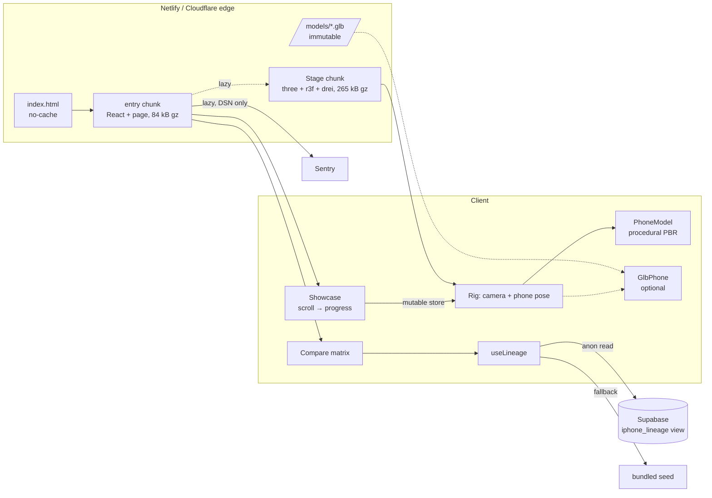

# iPhone 18 Pro Max experience: architecture

## 1. System overview



| Layer | Files | Notes |
| --- | --- | --- |
| Design tokens | `src/styles/index.css` | Tailwind v4 `@theme`. Every token becomes a utility (`bg-surface-1`, `text-fg-3`, `rounded-card`). |
| 3D stage | `src/three/*` | `Stage` is code-split. `timeline.ts` is pure and unit-tested. |
| Page sections | `src/components/*` | Header, Showcase (hero + sticky 3D), Bento, Compare. |
| Data | `src/data/*`, `supabase/migrations/*` | Seed and SQL are generated from one source (`npm run seed:sql`). |
| Comparison engine | `src/lib/compare.ts` | Pure functions, unit-tested. |
| Observability | `src/lib/observability.ts`, `ErrorBoundary.tsx` | Sentry is lazy and no-op without a DSN. |

## 2. Design system

### Color

| Token | Value | Use |
| --- | --- | --- |
| `ink` | `#000000` | Page canvas |
| `surface-1/2/3` | `#0b0b0d` / `#141417` / `#1d1d21` | Cards, table, raised chips |
| `hairline` / `hairline-strong` | white @ 8% / 16% | Borders, dividers |
| `fg` / `fg-2` / `fg-3` | `#f5f5f7` / `#c7c7cc` / `#86868b` | Text: 19.3:1, 12.5:1, 5.8:1 on black (all pass WCAG AA) |
| `accent` | `#2997ff` | Links, primary CTA, silicon |
| `ember` | `#ff7a3d` | Eyebrows, camera, pre-release marker |
| `gain` / `loss` | `#30d158` / `#ff453a` | Comparison deltas |

### Type (fluid, `clamp()`)

| Utility | Range | Weight / tracking |
| --- | --- | --- |
| `text-hero` | 48 → 136 px | 700, −0.045em |
| `text-display` | 36 → 72 px | 650, −0.035em |
| `text-title` | 24 → 40 px | 600, −0.022em |
| `text-lead` | 17 → 22 px | 400, −0.01em |

Font: Inter var with SF Pro as the system fallback on Apple devices.

### Surfaces and motion

- `glass`: 62% surface, `saturate(180%) blur(24px)`, hairline border. Used for the header, studio dock, 3D callouts and drawer.
- Easing: `--ease-apple` `cubic-bezier(.28,.11,.32,1)` for reveals; `--ease-spring` for press/hover scale.
- Cards: a 28 px radius and a cursor-following radial spotlight drawn with CSS variables, so there are no re-renders.
- `prefers-reduced-motion`: CSS transitions collapse, the 3D rig stops damping, parallax and float, and chapter jumps don't smooth-scroll.

## 3. Layout wireframe

```
┌──────────────────────────────────────────────────────────────┐
│ ▢ iPhone 18 Pro Max              Design Features Compare [●] │  sticky glass header (48px)
├──────────────────────────────────────────────────────────────┤
│                                                     ┊ Hero    │
│   INTRODUCING                                       ┊ 360°    │  #design: 700vh scroll track
│   iPhone 18 Pro Max       [ 3D canvas, sticky ]     ┊ 3/4     │  sticky 100svh stage
│   (title fades → story beats on the left)           ┊ Explode │  right rail = chapter jump
│                                                     ┊ Camera  │
│          ( ● ● ● ●  Ember Orange │ Studio Golden Noir )       │  studio dock (glass pill)
├──────────────────────────────────────────────────────────────┤
│  Features                                                     │  #features: 6-col bento
│ ┌───────────────────────────────┐ ┌───────────────┐           │
│ │ A20 Pro · 2 nm   [die art]    │ │ Camera 3×48MP │           │  4×2       2×2
│ │                               │ │ 0.5× 1× 4×    │           │
│ └───────────────────────────────┘ └───────────────┘           │
│ ┌──────────┐ ┌──────────┐ ┌──────────┐                        │  2 / 2 / 2
│ │ Display  │ │ Battery  │ │ Design   │                        │
│ └──────────┘ └──────────┘ └──────────┘                        │
│ ┌─────────────────────┐ ┌─────────────────────┐               │  3 / 3
│ │ Apple Intelligence  │ │ Connectivity        │               │
│ └─────────────────────┘ └─────────────────────┘               │
├──────────────────────────────────────────────────────────────┤
│  Compare                                    [Live · 24 models] │  #compare
│  [preset] [preset] [preset]                                   │
│  2026 [18 PM✓] 2025 [Air][17 PM✓] 2024 [16 PM✓] …  →scroll     │  year-grouped picker
│ ┌─────────────┬────────────┬────────────┬────────────┐        │
│ │ □ Only diff │ 18 Pro Max↗│ 17 Pro Max↗│ 16 Pro Max↗│        │  ↗ opens spec drawer
│ │ SILICON     │            │            │            │        │
│ │ Process     │ [2 nm ✓]   │ 3 nm  +50% │ 3 nm  +50% │        │  best = green pill
│ └─────────────┴────────────┴────────────┴────────────┘        │  delta vs baseline
└──────────────────────────────────────────────────────────────┘
```

Mobile (<640px): the bento stacks to one column, the chapter rail hides, the dock wraps to two rows, the table scrolls horizontally with a sticky label column, and portrait framing pulls the camera back (`fit`) and lifts the target so the phone clears the headline.

## 4. Scroll choreography

`p` is progress through the 700vh track. Poses are sampled with smoothstep between keyframes, then damped at λ=5 per frame.

| p | Shot | Camera | Phone | Explode |
| --- | --- | --- | --- | --- |
| 0.00 | Arrival | z = 9 | back, 3/4 turn | 0 |
| 0.12 | Hero | z = 3.7 | back | 0 |
| 0.12 → 0.40 | 360° | static | +2π yaw | 0 |
| 0.50 | Three-quarter | orbit right | | 0.15 |
| 0.64–0.72 | Exploded (hold) | wide 3/4, offset left of copy | | 1, chip glows |
| 0.84 | Camera close-up | 1.5 units from the plateau | back | 0 |
| 1.00 | Display | front | screen to camera | 0 |

Exploded layer offsets (Z, scene units = 100 mm): display +0.62, chip +0.34, logic board +0.26, battery −0.04, MagSafe −0.30, back −0.48, camera plateau −0.68.

## 5. Rendering and performance budget

| Target | How |
| --- | --- |
| First paint without waiting for 3D | Stage is `React.lazy`; the title card is DOM. |
| 60–120 FPS | One draw per part, shared materials, internals hidden while assembled. `PerformanceMonitor` lowers DPR on decline and `AdaptiveDpr` drops DPR while moving. `frameloop="never"` when the stage is off-screen. |
| No per-frame React work | Scroll progress is a mutable store; overlays, callouts and the rail are written directly to the DOM. |
| No HDRI download | The environment is baked once from `Lightformer` panels per studio (256² cube). |
| GLB delivery | `/models/*.glb` is immutable-cached and preloaded only for WebGL2 clients; Draco + WebP via gltf-transform. |
| Long-term caching | Hashed `/assets/*` are immutable for a year; `index.html` revalidates on every request. |

## 6. Degradation ladder

1. **WebGL2 + PBR**: full stage.
2. **WebGL1 or a major-performance-caveat GPU**: `webglTier()` routes to `StaticPhone` (CSS rendering in the live colorway). Story beats, dock and rail still work.
3. **Runtime failure** (shader compile, OOM): `ErrorBoundary area="stage"` catches it, reports to Sentry with tags, and swaps in `StaticPhone`.
4. **Context loss**: the `webglcontextlost` listener reports a warning and swaps in `StaticPhone`.
5. **Supabase down or misconfigured**: the bundled seed stays on screen and the error goes to Sentry.

## 7. Data model

See `supabase/migrations/0001_iphone_lineage.sql`.

- `chips(id, name, process_nm)` 1 → n `iphone_models(..., chip_id)`
- Enums: `display_tech`, `frame_material`, `price_basis` (`contract` for the 2008–2014 US two-year prices; the engine won't rank across bases).
- `iphone_lineage` is a `security_invoker` view whose columns match `IPhoneModel` one to one, cast to `float8` so PostgREST returns JSON numbers.
- RLS: public `select` for `anon` and `authenticated`, no write policies.
- `verified=false` marks pre-release rows; the UI shows a † marker and a disclaimer.

## 8. Visual-builder handoff (Webflow / WeWeb)

- Tokens map one to one onto Webflow Variables and WeWeb design-system tokens; the names match.
- Each section is a self-contained component with props (`flagship`, `models`, `finish`), so it can be shipped as a WeWeb coded component or a Webflow DevLink/code component.
- The stage takes only `finish`, `studio`, `active` and `reducedMotion`, so a builder can host it as a single embed.
